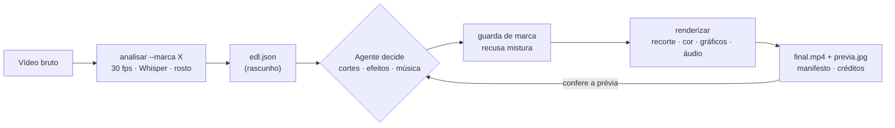
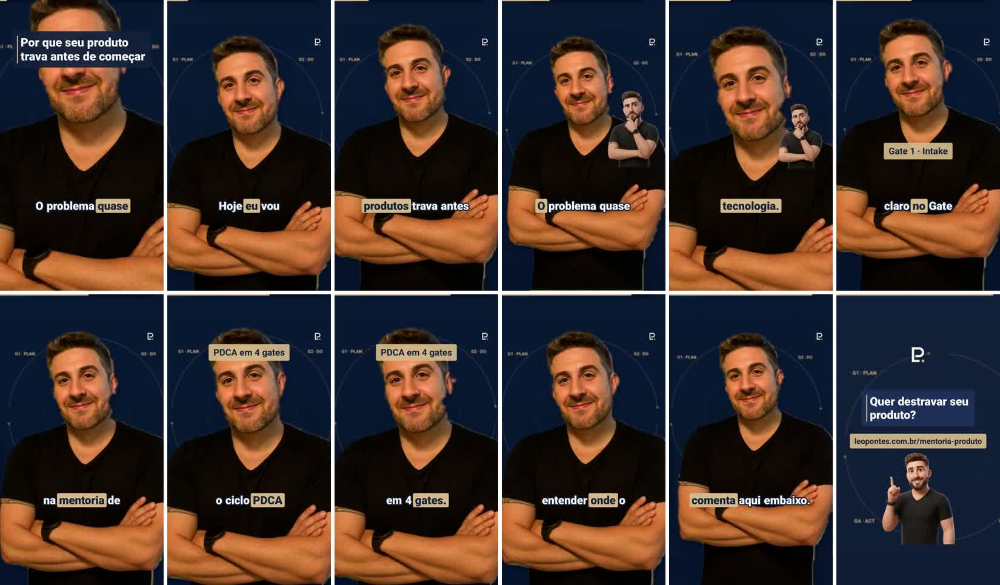
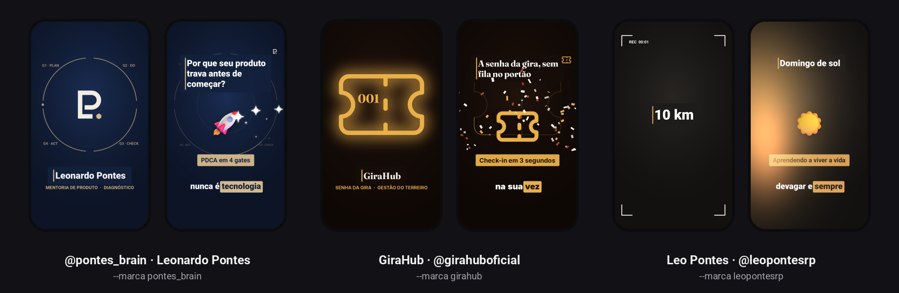
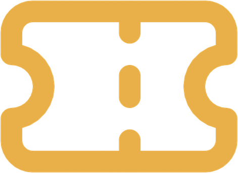
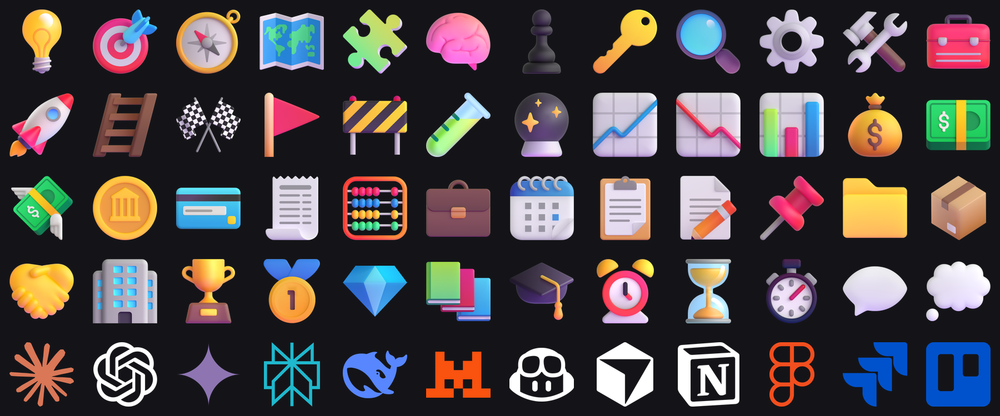
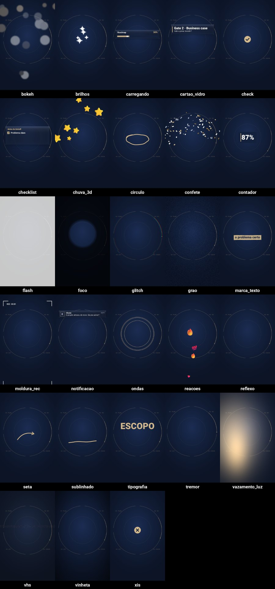

<p align="center">
  
</p>

<p align="center">
  <a href="#como-funciona">Como funciona</a> ·
  <a href="#marcas-atendidas">Marcas</a> ·
  <a href="#bibliotecas">Bibliotecas</a> ·
  <a href="#isolamento-entre-marcas">Isolamento</a> ·
  <a href="#começar">Começar</a> ·
  <a href="docs/">Documentação</a>
</p>

<p align="center">
  
  
  
  
</p>

# Editor de vídeo multimarca

Você grava falando para a câmera. Um agente de IA (Claude Code) assiste, decide os cortes, escolhe os efeitos e entrega o
Reel pronto, **com a identidade da marca certa e nada da marca errada**. Tudo roda no seu computador, sem assinatura e sem
mandar o vídeo para a nuvem.

O que um editor humano levaria uma hora para fazer sai em poucos minutos:

- **Corte inteligente**: silêncios, retakes ("corta, de novo") e muletas saem; fica só a última versão boa de cada frase.
- **Gancho nos 2 primeiros segundos**: a frase mais forte pode abrir o vídeo, sem inventar nada.
- **Legendas palavra por palavra**, com as palavras-chave destacadas na cor da marca e o vocabulário dela no Whisper.
- **Recorte do fundo com cabelo limpo** (Robust Video Matting) e troca por um fundo da marca, com parallax e sombra.
- **Títulos cinéticos, objetos 3D, efeitos e transições** que entram na palavra exata que os justifica.
- **Áudio de estúdio**: redução de ruído, de-esser, compressão leve e loudness em −16 LUFS com limitador.
- **Vinheta e CTA da marca**, marca d'água, barra de progresso e folha de prévia para o agente conferir o próprio trabalho.
- **Música real e licenciada**, com ducking sob a voz e o crédito pronto para colar na legenda.

## Como funciona



1. `analisar` normaliza o vídeo, transcreve com tempo por palavra, rastreia o rosto e escreve um rascunho do EDL.
2. O agente lê a transcrição e edita o `edl.json`: o que fica, onde entra cada efeito e com qual trilha.
3. `renderizar` passa pela **guarda de marca**, gera o vídeo e uma folha de prévia que o próprio agente abre e confere.
4. O vídeo sai com um selo da marca nos metadados, um `manifesto.json` com tudo o que foi usado e o crédito da música.

<p align="center"></p>
<p align="center"><sub>Folha de prévia de um vídeo real do @pontes_brain: gancho, legendas, Leo com contexto, destaques e CTA.</sub></p>

## Marcas atendidas

<p align="center"></p>

| | Marca | Identidade | Vinheta e fundo | Extras |
|---|---|---|---|---|
|  | **@pontes_brain**<br/>Leonardo Pontes · mentoria de produto | Papel & Marinho, Roboto, Monograma LP | Os 4 gates do PDCA se desenham e o LP é traçado | Leo 3D com contexto, CTA para a mentoria, sem música |
|  | **GiraHub**<br/>@girahuboficial · gestão do terreiro | Paleta terra e ouro, Fraunces + Inter | O ticket da senha da gira acende | CTA para girahub.com.br, música opcional |
| — | **@leopontesrp**<br/>Instagram pessoal · "aprendendo a viver a vida" | Grafite e âmbar, Roboto | Sem vinheta, sem logo, sem CTA | Música real obrigatória, vídeo do dia a dia com vários clipes |

Cada marca vive na própria pasta, `marcas/<id>/`, com `marca.json` (cores, fontes, vinheta, CTA, vocabulário, termos
exclusivos) e os arquivos que são só dela: logo, vinheta, Leo, objetos 3D próprios. **Marca nova** é copiar
`marcas/modelo/` e trocar o que muda; com a vinheta `logo` e o fundo `anel`, ela sai pronta, sem programar nada.

<p align="center">
  
  &nbsp;&nbsp;&nbsp;
  
</p>

## Bibliotecas

Quatro bibliotecas compartilhadas por todas as marcas. Tudo é desenhado **com a paleta da marca ativa**, então o mesmo efeito
sai azul e champanhe no @pontes_brain e terra e ouro no GiraHub.

### 3D: 215 objetos

<p align="center"></p>

- **167 renders 3D** (Microsoft Fluent Emoji 3D, licença MIT) em 19 categorias: gestão (semáforo de status, projeto
  zumbi, tesoura de escopo, extintor, boia…), dinheiro, crescimento, estratégia, tempo, conquista, reações, vida… Entram com mola, flutuam e saem girando.
- **48 logos extrudados** (Simple Icons, CC0): Claude, ChatGPT, Gemini, Notion, Figma, Trello, WhatsApp, Instagram, Pix,
  Nubank… O motor dá espessura, luz e reflexo a partir do PNG plano.
- Objetos de identidade ficam com a marca dona (`marcas/<id>/3d/`) e só aparecem para ela: o @pontes_brain tem o
  Monograma LP, as placas dos gates G1 a G4 e o ciclo PDCA em 3D.

```bash
editor.py biblioteca listar 3d dinheiro          # busca por nome, tag ou categoria
editor.py biblioteca baixar 3d "Party popper"   # acrescenta um emoji 3D do Fluent ao catálogo
```

### Músicas: 35 faixas reais, CC BY 4.0

Gravações reais de Kevin MacLeod (incompetech) e Alex Morgan (Free Music Archive), **todas com licença para uso comercial**,
catalogadas com clima, energia (1 a 5), BPM, gênero, instrumentos, duração, se funciona sob fala e usos sugeridos. O
render grava o crédito certo em `creditos.txt`. Lista completa em [biblioteca/musicas/CREDITOS.md](biblioteca/musicas/CREDITOS.md).

```bash
editor.py biblioteca listar musicas --clima esperança
editor.py biblioteca listar musicas bossa
editor.py biblioteca baixar musicas              # ≈ 230 MB, uma vez; os arquivos ficam fora do Git
```

### Efeitos: 29 layers

<p align="center"></p>

Luz e textura (vazamento de luz, reflexo de vidro, grão, vinheta, VHS, glitch, flash, tremor, foco), celebração (confete,
brilhos, bokeh, chuva de objetos 3D, reações de live, ondas), anotação (círculo desenhado, sublinhado, seta, marca-texto,
check, xis), informação (contador, cartão de vidro líquido, notificação, barra carregando, checklist, moldura REC) e
tipografia cinética. Todos são determinísticos, aceitam só papéis da paleta como cor e entram ancorados na fala, como qualquer
elemento do EDL.

```jsonc
{"tipo": "efeito", "nome": "confete", "na": "deu certo", "cor": "champanhe"}
{"tipo": "efeito", "nome": "contador", "na": "oitenta e sete por cento", "ate": 87, "sufixo": "%"}
```

### Sons: 38 efeitos sonoros

Whooshes, risers, impactos, sons de interface, papel, lápis, teclado e notificação: gravações **CC0** (Kenney, qubodup,
StarNinjas…) e efeitos **próprios** desenhados em `ferramentas/montar_sons.py`. Cada som sabe onde fica o próprio pico,
então o whoosh passa exatamente no corte e o riser chega exatamente na palavra. Marcas com `"sons": {"modo": "biblioteca"}`
(o @pontes_brain) tocam o som certo em cada transição, elemento e efeito; as outras seguem com o whoosh e o pop sintéticos.

```jsonc
{"tipo": "som", "nome": "riser-curto", "na": "o segredo"}
{"tipo": "destaque", "texto": "ROI", "na": "retorno", "som": "moedas"}
```

Transições: `push`, `whip`, `zoom`, `slide`, `flash`, `dissolve` e, desde a 2.1, `giro` (giro 3D), `rasgo` (papel rasgado),
`vidro` (vidro líquido) e `luz` (queima de luz).

## Isolamento entre marcas

O pior erro de um editor multimarca é entregar o vídeo de um cliente com a cara de outro. Aqui isso é barrado em camadas:

| Camada | O que impede |
|---|---|
| **Uma marca por processo, sem padrão** | `--marca` é obrigatório; nada é desenhado sem marca ativa. |
| **Pastas trancadas** | O motor só abre arquivos da pasta da marca ativa ou das bibliotecas compartilhadas. |
| **Identidade com dono** | Vinheta PDCA e fundo PDCA só no @pontes_brain; ticket só no GiraHub; Leo só no @pontes_brain. |
| **Termos exclusivos** | Título, legenda ou CTA com "mentoria de produto" fora do @pontes_brain, ou "senha da gira" fora do GiraHub, é recusado. |
| **EDL e análise carimbados** | O `edl.json` e a `analise.json` guardam a marca; se não baterem com a ativa, o render para. |
| **Auditoria** | Todo arquivo aberto no render é registrado e conferido no fim. |
| **Selo no vídeo** | `editor.py conferir final.mp4 --marca girahub` lê o selo gravado nos metadados antes da entrega. |

Os detalhes estão em [docs/marcas.md](docs/marcas.md).

## Começar

```bash
git clone git@github.com:leonfpontes/edicao-video.git ~/Documents/Dev/edicao-video
cd ~/Documents/Dev/edicao-video
bash setup-mac.sh                                  # ffmpeg, Python, modelos e músicas (≈ 10 min, uma vez)
```

Depois, abra o Claude Code na pasta e peça:

> Edite ~/Movies/meu-video.mov para o @pontes_brain.

O agente usa a skill da marca (`skills/editor-video-<marca>/SKILL.md`), analisa, edita, confere a prévia e entrega
`AAAA-MM-DD-tema.mp4` com a legenda do post. Se preferir comandar na mão:

```bash
.venv/bin/python editor.py analisar ~/Movies/meu-video.mov --marca pontes_brain
.venv/bin/python editor.py renderizar ~/Movies/meu-video_edicao/edl.json --rapido
.venv/bin/python editor.py conferir ~/Movies/meu-video_edicao/final.mp4 --marca pontes_brain
```

## Qualidade

- **114 testes de unidade** (`make testes`): validação das marcas, guarda, efeitos, catálogos.
- **Regressão visual** (`make regressao`): a folha de cada marca é comparada pixel a pixel com a referência, a guarda é
  testada contra as outras marcas e um vídeo sintético é renderizado de ponta a ponta, com loudness medido.
- **CI no GitHub Actions** em todo PR: lint (ruff), testes, bibliotecas e regressão.

## Documentação

| Documento | Para quê |
|---|---|
| [docs/arquitetura.md](docs/arquitetura.md) | Como o motor é organizado e o caminho de um quadro |
| [docs/edl.md](docs/edl.md) | Referência completa do `edl.json` |
| [docs/marcas.md](docs/marcas.md) | Criar uma marca e como funciona o isolamento |
| [docs/bibliotecas.md](docs/bibliotecas.md) | 3D, músicas e efeitos: usar, acrescentar e licenciar |
| [docs/gravacao.md](docs/gravacao.md) | Dicas de gravação que fazem mais diferença que qualquer efeito |
| [docs/testes.md](docs/testes.md) | Testes, regressão visual e CI |
| [AGENTS.md](AGENTS.md) · [CLAUDE.md](CLAUDE.md) | Regras para agentes de IA que editam vídeos ou mexem no código |

## Feito com

Python, ffmpeg, [faster-whisper](https://github.com/SYSTRAN/faster-whisper),
[MediaPipe](https://ai.google.dev/edge/mediapipe), [Robust Video Matting](https://github.com/PeterL1n/RobustVideoMatting),
OpenCV e Pillow. Recursos de terceiros e licenças em [docs/bibliotecas.md](docs/bibliotecas.md#licenças).

---

<sub>© Leonardo Pontes. Código proprietário; veja [LICENSE](LICENSE). Os recursos das bibliotecas mantêm as licenças
originais (MIT, CC0 e CC BY 4.0). Logos de terceiros são marcas registradas dos donos e entram só em uso editorial.</sub>
