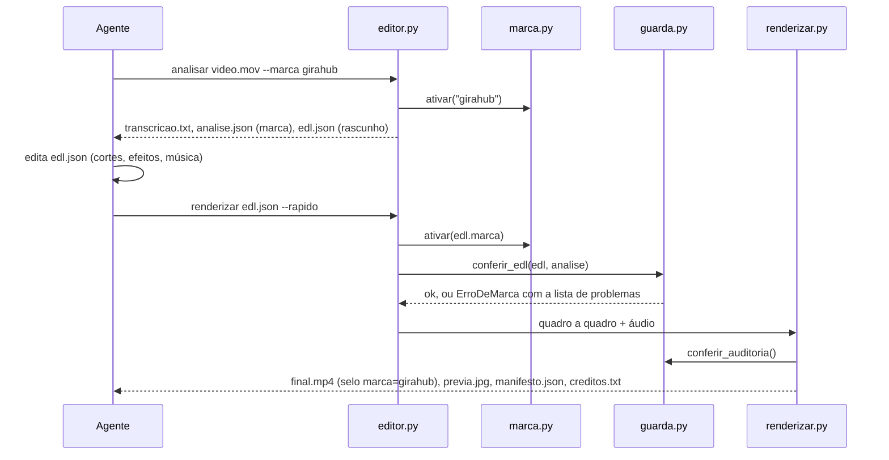

# Arquitetura

O editor é um pacote Python (`motor/`) com uma linha de comando fina (`editor.py`). Não há servidor nem nuvem: tudo roda
na máquina, com ffmpeg, Whisper, MediaPipe, Robust Video Matting (onnxruntime), OpenCV e Pillow.

```
edicao-video/
├── editor.py                 # atalho: from motor.cli import main
├── motor/                    # o motor (código compartilhado por todas as marcas)
├── marcas/<id>/              # identidade de cada marca: marca.json + arquivos próprios
├── biblioteca/               # 3D, músicas, efeitos e fontes (todas as marcas)
├── skills/<skill>/SKILL.md   # instruções do agente editor, uma por marca
├── modelos/                  # recorte, rosto e redução de ruído (≈ 16 MB, no Git)
├── testes/referencia/        # folhas de referência da regressão visual
├── tests/                    # testes de unidade (pytest)
├── ferramentas/              # scripts que regeram catálogos e imagens do README
├── exemplos/                 # EDL e prévia de um vídeo real
└── docs/                     # esta documentação
```

## Módulos

| Módulo | Responsabilidade |
|---|---|
| `cli.py` | Subcomandos e tratamento de `ErroDeMarca` |
| `config.py` | Caminhos (`RAIZ`, `MARCAS`, `BIBLIOTECA`…), FPS e formatos |
| `marca.py` | Carrega, valida e **ativa** uma marca; sandbox de arquivos (`arquivo_marca`); auditoria |
| `guarda.py` | Confere o EDL e a auditoria contra a marca ativa (termos, arquivos, Leo, CTA, 3D, música, efeitos) |
| `bibliotecas.py` | Catálogos 3D e de músicas, busca, download verificado, política de música |
| `efeitos.py` | Registro e implementação dos 20 layers de efeito |
| `analisar.py` | Normaliza, transcreve, rastreia rosto, escreve `analise.json` e o rascunho do `edl.json` |
| `renderizar.py` | Aplica o EDL: cortes, câmera, recorte, fundo, cor, elementos, legendas, vinheta, CTA, áudio, selo |
| `camera.py` | Rosto suavizado, câmera contínua entre cortes, zooms e transições |
| `segmentacao.py` | Recorte da pessoa (RVM, com MediaPipe como reserva) |
| `fundo.py` | Fundo da marca com luz difusa e o motivo dela (PDCA, ticket, anel) |
| `elementos.py` | Título, destaque, Leo, objeto 3D, efeito, imagem, b-roll; âncoras pela fala |
| `graficos.py` | Colagem com alfa, sombra, giro 3D, quebra de texto, cartão cinético |
| `legendas.py` | Legenda palavra a palavra com marcação na cor de destaque |
| `vinhetas.py` | Vinheta de abertura de cada marca e cartão de CTA |
| `cor.py`, `audio.py`, `movimento.py`, `util.py` | LUT de cor, loudness e SFX, curvas de easing, ffmpeg |
| `testar.py` | Regressão visual, isolamento e render ponta a ponta |
| `comandos.py` | `marcas`, `biblioteca`, `conferir` |

## O caminho de um vídeo



## O caminho de um quadro

Para cada quadro de saída, `renderizar` faz, nesta ordem:

1. **Câmera**: posição do rosto suavizada, zoom-base contínuo entre cortes, zooms de ênfase, respiração lenta.
2. **Fundo**: original, desfocado, da marca (com parallax) ou imagem; o recorte RVM separa a pessoa e a sombra é desenhada.
3. **Cor**: LUT de contraste e calor, saturação e nitidez.
4. **Transição** de entrada do segmento (push, zoom, slide, flash, dissolve, whip).
5. **Elementos** da fase `elementos`: títulos, destaques, Leo, objetos 3D, efeitos, imagens, b-roll.
6. **Legenda** palavra a palavra.
7. **Marca d'água** e **barra de progresso**.
8. **Efeitos de fase `pos`** (grão, vinheta, glitch, vazamento de luz…), por cima de tudo.

A vinheta da marca abre o vídeo e o cartão de CTA o fecha. O áudio segue os mesmos cortes, passa por limpeza de voz,
recebe SFX e música (com ducking) e é normalizado em duas passadas para −16 LUFS, com limitador no fim.

## Princípios

- **Determinismo**: o mesmo EDL gera o mesmo vídeo. Efeitos usam semente fixa; a regressão compara pixel a pixel.
- **Marca é estado explícito**: nada lê cor, fonte ou arquivo de marca sem `ativar()`; não existe marca padrão.
- **Tempos na linha do tempo original**: o agente pensa na transcrição; o motor faz o mapeamento depois dos cortes.
- **Sem dependência de serviço**: nada de API paga; músicas e 3D são baixados uma vez e conferidos por sha256.
